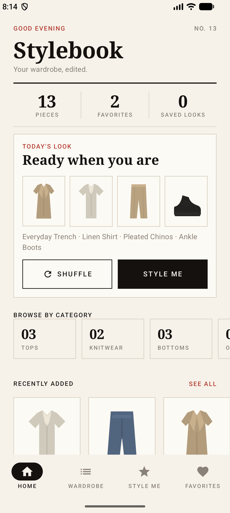
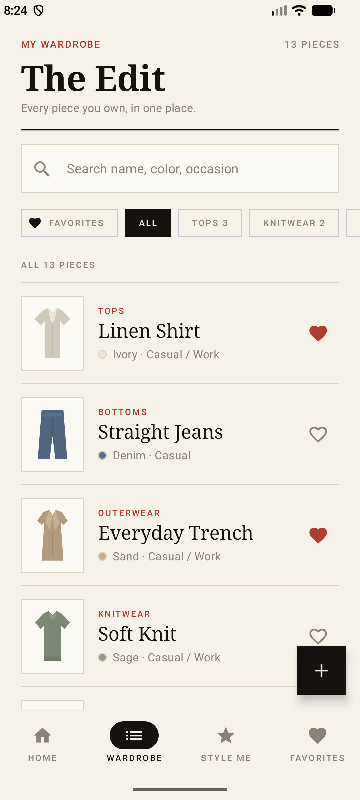
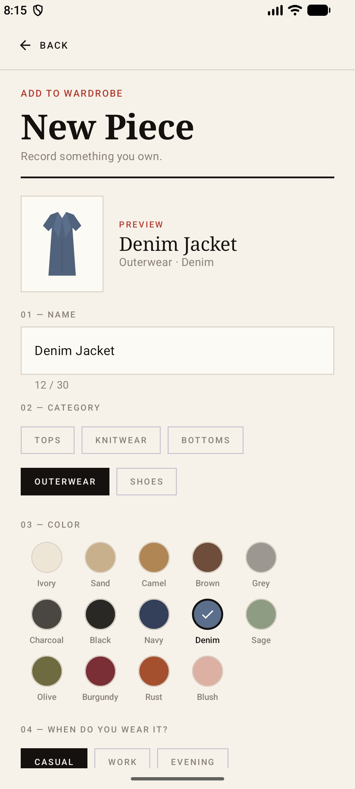
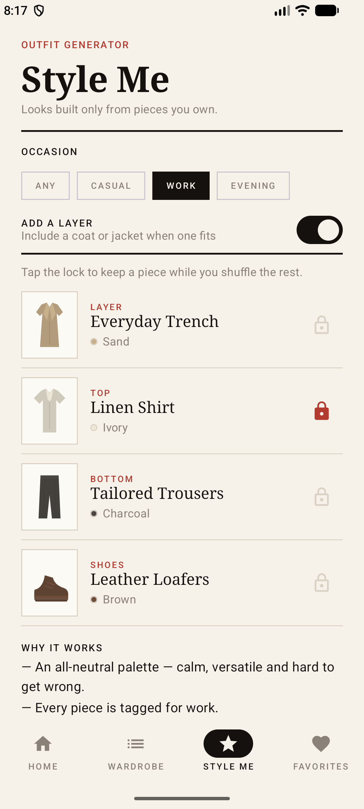
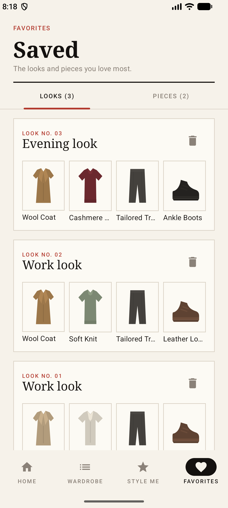
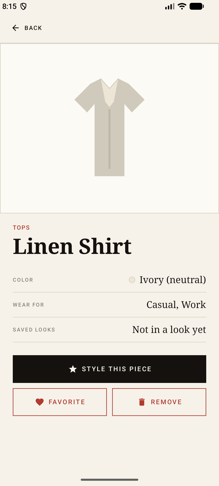

# StyleBook — Digital Wardrobe (Midterm Project)

StyleBook is a native Android app, built with **Kotlin** and **Jetpack Compose**, that helps you answer *"what do I wear today?"* using only the clothes you already own.

You keep a digital catalogue of your pieces. You can search and filter it, and add new items through a validated form. A rule-based **Outfit Generator** builds complete looks from your wardrobe and explains why each combination works. Looks and pieces you like can be saved to **Favorites**.

> The whole app runs offline. It needs no backend, no network and no API keys, and all images are local vector drawables.
> **Data lives in memory only.** It survives screen rotation, but it resets to the sample wardrobe when the app process is restarted. See [Limitations](#limitations).

## Screenshots

| Home | My Wardrobe | Add a Piece |
|---|---|---|
|  |  |  |
| **Outfit Generator** | **Favorites** | **Item Detail** |
|  |  |  |

1. **Home**: wardrobe stats, today's generated look with *Shuffle*, category shortcuts, and recently added pieces.
2. **My Wardrobe**: live search plus category and favorite filters on a `LazyColumn`.
3. **Add a Piece**: form with inline validation (name, category, color, occasions).
4. **Outfit Generator**: a *Work* look with the Linen Shirt locked, the layer toggle, and the "Why it works" notes.
5. **Favorites**: saved looks (with remove + undo). A second tab shows favorite pieces.
6. **Item Detail**: piece info, *Style this piece*, favorite, and remove with undo.

## Features

| # | Feature | What the user can do |
|---|---|---|
| 1 | **Wardrobe catalogue** | Browse every piece. Search by name, category, color or occasion. Filter by category chip or favorites only. A friendly empty state appears when nothing matches. |
| 2 | **Add Clothing Item** | Add a piece with name, category, color and occasions. Validation covers required fields, name length (2–30 characters), and duplicate names within the same category. Errors appear inline only after the first submit. A snackbar confirms the save. |
| 3 | **Outfit Generator** | Builds a top + bottom + shoes (+ optional layer) look **only from pieces you own**. You can pick an occasion (Any, Casual, Work, Evening), toggle the layer, **lock** pieces you want to keep, and **shuffle** the rest. The generator applies color harmony: at most one accent color, with neutrals around it. It also avoids repeating the previous look and shows a *"Why it works"* explanation. If the wardrobe lacks a required category, it says which pieces are missing. |
| 4 | **Favorites** | Save generated looks (duplicates are detected) and favorite individual pieces. Both are shown on one screen with two tabs. Saved looks can be removed with **Undo**. |
| 5 | **Item detail** | See a piece's color, occasions and how many saved looks use it. *Style this piece* opens the generator with that piece locked. You can also favorite it, or **remove** it with **Undo**. Undo also restores any saved looks that used the piece. |

## Tech stack

| | |
|---|---|
| Language | Kotlin 2.2.10 |
| UI | Jetpack Compose (BOM 2026.02.01), Material 3 |
| Navigation | Navigation Compose 2.10.2 |
| State | `ViewModel`, `StateFlow`, `collectAsStateWithLifecycle()` (lifecycle 2.11.0) |
| Async | Kotlin Coroutines (`viewModelScope`, `Channel`, `combine`, `stateIn`) |
| Tests | JUnit 4 + `kotlinx-coroutines-test` 1.9.0 |
| Build | AGP 9.4.1, compileSdk/targetSdk 37, minSdk 24 |
| Package | `com.example.stylebook` |

## Architecture

```
┌──────────────────────── UI layer (Compose) ────────────────────────┐
│ StyleBookApp: NavHost, bottom bar, FAB, Snackbar                   │
│ screens/*: stateless, receive state + callbacks                    │
│ components/*: reusable composables                                 │
└──────────────▲─────────────────────────────────┬───────────────────┘
               │ StateFlow<UiState>              │ events (onClick…)
               │ collectAsStateWithLifecycle()   ▼
┌──────────────┴──────────── ViewModels ─────────────────────────────┐
│ WardrobeViewModel: search/filters, add, favorite, delete + undo    │
│ OutfitViewModel: generate, lock, shuffle, save/remove looks        │
└──────────────▲─────────────────────────────────┬───────────────────┘
               │ StateFlow (items, savedOutfits) │ calls
┌──────────────┴──── Data + Domain (plain Kotlin, no Android UI) ────┐
│ WardrobeRepository: single source of truth (in memory)             │
│ OutfitGenerator: pure outfit rules (testable, injectable Random)   │
│ ClothingItemValidator: form validation rules                       │
│ Models: ClothingItem, Outfit, Category, ClothingColor, Occasion    │
└────────────────────────────────────────────────────────────────────┘
```

- **Unidirectional data flow.** State flows down from Repository → ViewModel → UI, and events flow up from UI → ViewModel → Repository.
- Both ViewModels observe the **same repository** (provided by `AppContainer`). A piece added on the Add screen therefore shows up immediately in the Wardrobe, on Home and in the generator.
- Business rules (`OutfitGenerator`, `ClothingItemValidator`) contain no Compose or Android code, so they are unit-tested directly.

### Project structure

```
app/src/main/java/com/example/stylebook/
├── MainActivity.kt                      # Entry point, sets Compose content
├── data/
│   ├── AppContainer.kt                  # Provides the shared repository (manual DI)
│   ├── WardrobeRepository.kt            # In-memory StateFlows: items + saved outfits
│   ├── SampleClothingData.kt            # 13 sample pieces
│   └── model/                           # ClothingItem, Outfit, Category(+OutfitSlot), ClothingColor, Occasion
├── domain/
│   ├── OutfitGenerator.kt               # Outfit rules: slots, occasion, color harmony, locks, no-repeat
│   └── ClothingItemValidator.kt         # AddItemForm + validation rules
└── ui/
    ├── StyleBookApp.kt                  # Scaffold, NavHost, bottom bar, FAB, snackbars
    ├── navigation/StyleBookDestinations.kt  # Routes + top-level tabs
    ├── viewmodel/                       # WardrobeViewModel, OutfitViewModel, UserMessage
    ├── screens/                         # Home, Wardrobe, AddItem, ItemDetail, OutfitGenerator, Favorites
    ├── components/                      # Reusable composables (GarmentImage, ClothingItemRow/Tile, OutfitBoard, …)
    └── theme/                           # Material 3 colors, typography, theme (light + dark)
app/src/test/java/com/example/stylebook/ # 18 unit tests
```

## How the midterm requirements are met

| Requirement | Implementation |
|---|---|
| ≥ 3 screens + Navigation Compose | 6 destinations in one `NavHost` (`ui/StyleBookApp.kt`): `home`, `wardrobe`, `generator`, `favorites`, `add_item`, `item/{itemId}` (typed `Int` argument). |
| ≥ 3 meaningful features | Wardrobe search/filter, Add with validation, Outfit Generator, Favorites, Item detail with undo (see [Features](#features)). |
| Material 3 + reusable composables | `MaterialTheme` with custom light/dark schemes, plus Material 3 components (`NavigationBar`, `Scaffold`, `SnackbarHost`, `PrimaryTabRow`, `Switch`, `FilterChip`, `OutlinedTextField`, `Card`/`OutlinedCard`, `FloatingActionButton`, `LazyColumn`/`LazyRow`). Reusable pieces live in `ui/components/`. |
| `remember` | Home greeting and per-category counts (`remember(items)`), `SnackbarHostState`, `NavController`. |
| `rememberSaveable` | Add form fields + `submitted` flag; Favorites selected tab. |
| State hoisting | Every screen is stateless: it receives `state` + `onXxx` lambdas. Components like `ClothingItemRow`, `FavoriteButton`, `OutfitBoard` and `ColorChoice` are fully hoisted. |
| ViewModel + StateFlow + `collectAsStateWithLifecycle()` | `WardrobeViewModel` / `OutfitViewModel` expose `StateFlow<UiState>` built with `combine(...).stateIn(...)`, collected in `StyleBookApp`. |
| Coroutines | `viewModelScope`, `Channel` for one-off snackbar messages, `merge` + `LaunchedEffect` collection, and a `repository.items.collect { }` that rebuilds the current look if one of its pieces is deleted. |
| Separation of UI / logic / state | See [Architecture](#architecture). |
| Configuration changes | ViewModels survive rotation. `rememberSaveable` restores form input and the tab. Navigation back stack is restored by `NavHost`. Verified on an emulator by rotating with a half-filled form and an active filter. |

## Running the app

### Android Studio (recommended)
1. Clone the repository and open the project folder in Android Studio.
2. Wait for Gradle sync to finish.
3. Select an emulator or a connected device (Android 7.0 / API 24 or newer).
4. Press **Run ▶**.

### Command line
Gradle needs JDK 17+. The JDK bundled with Android Studio works:

```bash
# macOS example; adjust the path for your system
export JAVA_HOME="/Applications/Android Studio.app/Contents/jbr/Contents/Home"

./gradlew :app:assembleDebug        # build -> app/build/outputs/apk/debug/app-debug.apk
./gradlew :app:testDebugUnitTest    # run the unit tests
./gradlew :app:installDebug         # install on a running emulator/device
```

## Tests

18 JVM unit tests in `app/src/test/`:

- `OutfitGeneratorTest`: one piece per required slot, occasion filter + at most one accent color, layer toggle, locked piece kept while shuffle changes the rest, and missing categories reported.
- `WardrobeViewModelTest`: required-field validation, duplicate names, adding (trimmed, first in list, snackbar message), search, combined category/favorite filters, favorite toggle, and delete + undo at the same position.
- `OutfitViewModelTest`: first look generated immediately, saving with duplicate detection, lock survives shuffle, *Style this piece*, occasion change, and deleting a piece (its saved looks are removed and the current look is rebuilt).

`MainDispatcherRule` swaps `Dispatchers.Main` for a test dispatcher so `viewModelScope` can run on the JVM.

## Limitations

- **No persistent storage.** The wardrobe and saved looks are kept in memory in `WardrobeRepository`. They survive configuration changes but reset to the sample data when the app process is killed or restarted.
- Garment images are tinted vector illustrations chosen by category. Taking photos is not implemented.
- The outfit generator is rule-based (slots, occasion, color harmony), not machine learning.

## Future extensions

The design leaves room for these without rewriting the app:

- **Persistence:** replace the `MutableStateFlow`s in `WardrobeRepository` with Room/DataStore. ViewModels and UI stay unchanged because they only depend on the repository's flows.
- **StyleProfile:** add a model (preferred colors, fit, style), and pass it to `OutfitGenerator` as one more parameter to weight the candidates.
- **Weather recommendations:** add a `WeatherProvider` in `domain/`. The generator already has an `includeLayer` switch and occasion filter that weather could drive.
- **Simulated virtual try-on:** `OutfitBoard` already stacks pieces by slot, so a layered "mannequin" composable could reuse `Outfit.pieces`.

## Defense material

The demo script and defense notes (navigation, ViewModel, StateFlow, `remember` vs `rememberSaveable`, state hoisting, configuration changes) are in **[docs/DEFENSE.md](docs/DEFENSE.md)**.
