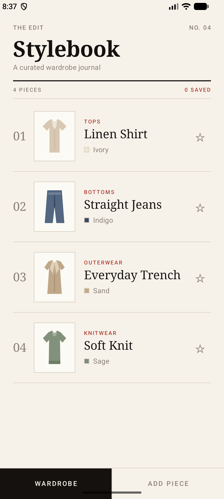
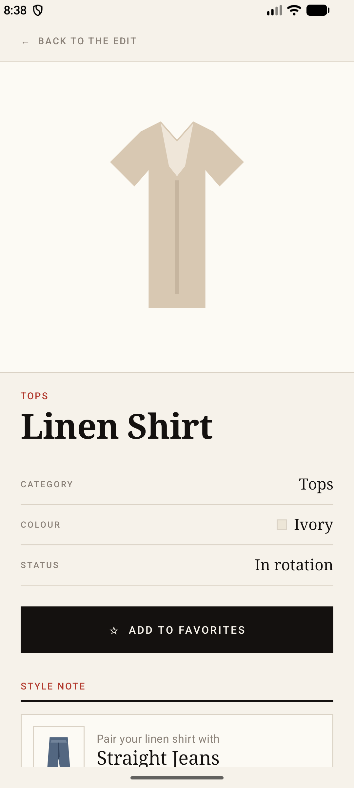

# StyleBook — Digital Wardrobe (HW2 / Task 2)

StyleBook is a native Android application built with **Kotlin** and **Jetpack Compose**. It is a small, editorial-styled *digital wardrobe journal*: you can browse a curated collection of clothing pieces, view the details of any piece, mark favorites, get a simple outfit pairing suggestion, and add new pieces of your own.

This is the HW2 (Task 2) foundation that will later grow into the StyleBook midterm project.

> The course index lives on the [`master`](../../tree/master) branch. This `hw2` branch contains the complete Android Studio project.

## Screenshots

| Wardrobe (Home) | Item Details | Add Piece |
|---|---|---|
|  |  |  |

## Features

- **Wardrobe screen** — an editorial masthead header plus a `LazyColumn` list of clothing pieces, each showing a number, illustration, name, category, color swatch, and a favorite star.
- **Item details screen** — a large illustration, a spec sheet (category / colour / status), a favorite toggle, and a **Style Note** card that suggests an outfit pairing from another piece in the wardrobe.
- **Add Piece screen** — a form (`TextField`s, category chips, `Button`) with required-field validation and success/error feedback. New pieces appear in the wardrobe immediately.
- **Two bottom tabs** to move between the wardrobe and the add-piece form.
- **Favorites** — tapping the star on any card or the button on the details screen instantly updates the UI.
- **Bundled vector artwork** — all illustrations are local drawables, so the app needs **no network access**.
- **Light and dark themes** with a warm "paper + ink" Material 3 color scheme.

## Tech stack

- Kotlin
- Jetpack Compose + Material 3
- `ViewModel` + Kotlin `StateFlow`
- `collectAsStateWithLifecycle()` for lifecycle-aware state collection
- Min SDK 24, target/compile SDK 37

## Project structure

```
app/src/main/java/com/example/stylebook/
├── MainActivity.kt                  # Entry point; sets the Compose content
├── data/
│   ├── model/ClothingItem.kt        # Data model (id, name, category, color, imageRes, isFavorite)
│   └── SampleClothingData.kt        # Initial sample wardrobe
└── ui/
    ├── StyleBookApp.kt              # App scaffold + simple tab/screen switching
    ├── Modifiers.kt                 # Small reusable Modifier helper
    ├── screens/
    │   ├── WardrobeScreen.kt        # Home list + reusable card/list/header/favorite composables
    │   ├── AddItemScreen.kt         # Add-piece form with validation
    │   └── ItemDetailScreen.kt      # Details + outfit suggestion
    ├── viewmodel/WardrobeViewModel.kt   # State + business logic (StateFlow)
    └── theme/                       # Color, Type, Theme (Material 3)
```

## How each requirement is met

| Requirement | Where |
|---|---|
| Kotlin + Jetpack Compose | Whole project |
| Material 3 + consistent styling | `ui/theme/`, all screens |
| ≥ 3 reusable composables | `WardrobeHeader`, `ClothingItemList`, `ClothingItemCard`, `FavoriteButton`, plus form helpers |
| `Row`, `Column`, `Box` | All screens |
| `LazyColumn`, `Card`, `Text`, `Image` | `WardrobeScreen` (LazyColumn/Image/Text), `ItemDetailScreen` (OutlinedCard/Image/Text) |
| ≥ 2 meaningful interactions | Add a piece, toggle favorite, open details, pick a category |
| Input components | `OutlinedTextField`, `Button`, selectable category chips |
| UI updates on action | Adding/favoriting updates the list instantly |
| `remember` + `rememberSaveable` | `rememberSaveable` for form fields / current tab / selected item; `remember` for the category list |
| ≥ 1 `ViewModel` | `WardrobeViewModel` exposes `StateFlow<WardrobeUiState>` |
| UI / state separation | Composables are stateless and driven by the ViewModel via callbacks |
| Survives Activity recreation | ViewModel keeps the wardrobe across rotation; `rememberSaveable` restores UI state |

## Running the app

### In Android Studio (recommended)
1. Open the project folder in Android Studio.
2. Let Gradle sync finish.
3. Select an emulator or a connected device.
4. Press **Run ▶**.

### From the command line
```bash
./gradlew :app:assembleDebug        # build the debug APK
./gradlew :app:testDebugUnitTest    # run the ViewModel unit tests
```
The built APK is at `app/build/outputs/apk/debug/app-debug.apk`.

## State management: `remember` vs `rememberSaveable` vs `ViewModel`

- **`remember`** keeps a value across *recompositions* only. It is lost on configuration change (e.g. rotation) and on process death. Used here for throwaway UI data such as the static category list.
- **`rememberSaveable`** also survives *Activity recreation* (rotation, system-initiated recreation) by storing values in a `Bundle`. It only supports simple, saveable types. Used here for the form fields, the current tab, and the selected item id. It is **not** a database.
- **`ViewModel`** holds screen/app state and business logic that survives configuration changes, and keeps UI logic out of composables. Used here for the in-memory wardrobe collection and the add/favorite actions, exposed as a `StateFlow`.

### What happens during rotation
The `WardrobeViewModel` instance is retained, so the wardrobe collection and favorites stay intact. `rememberSaveable` restores the open screen, selected item, and any text already typed in the form.

### What happens if the process is terminated
A `ViewModel` is **not** persistent storage. If Android kills the app process, the in-memory wardrobe resets to the sample data. `rememberSaveable` can restore supported UI state if the OS saved it, but it is not a database — durable persistence (e.g. Room/DataStore) is intentionally out of scope for this assignment.
