# StyleBook — Digital Wardrobe (HW3: MVVM + Room)

StyleBook is a native Android app, built with **Kotlin** and **Jetpack Compose**, that helps you answer *"what do I wear today?"* using only the clothes you already own.

You keep a digital catalogue of your pieces. You can search, filter and sort it, and add or edit pieces through a validated form. A rule-based **Outfit Generator** builds complete looks from your wardrobe and explains why each combination works. You can save looks you like to **Favorites**. The **Wear Diary** records what you actually wore and points out the pieces you have forgotten about.

> The whole app runs offline. It needs no backend, no network and no API keys, and all images are local vector drawables.
> **All data is stored in a Room database.** Pieces, favorites, saved looks and the diary are still there after you close and restart the app.

## Screenshots

### Additional feature: Wear Diary

| Log a look ("Wear today") | Diary: stats, forgotten pieces, log | Wardrobe sorted by "Most worn" |
|---|---|---|
| 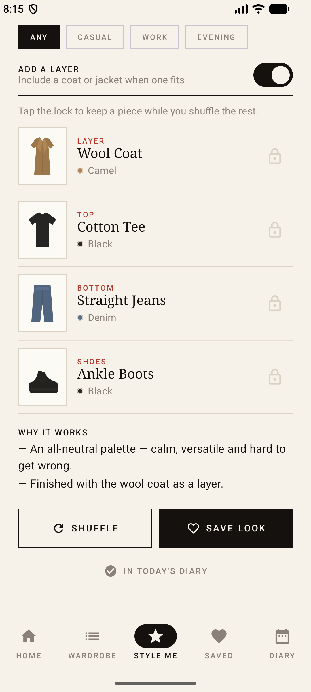 | 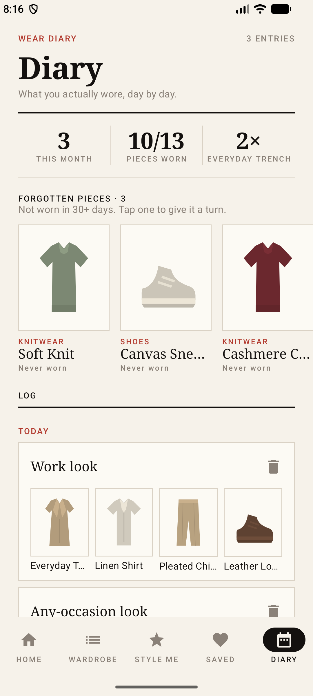 | 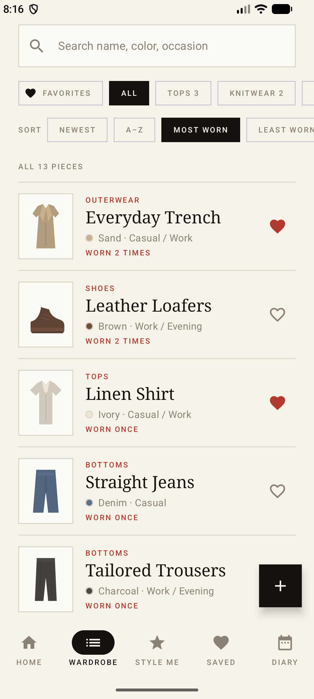 |

1. **Wear today**: the look on the generator is logged; the button turns into *In today's diary*.
2. **Diary**: entries this month, pieces worn (10/13), most-worn piece, forgotten pieces and the day-by-day log.
3. **Sort by wear**: the wardrobe is ordered by how often each piece appears in the diary.

### CRUD

| Item detail with wear stats | Delete confirmation | Edit a piece |
|---|---|---|
| 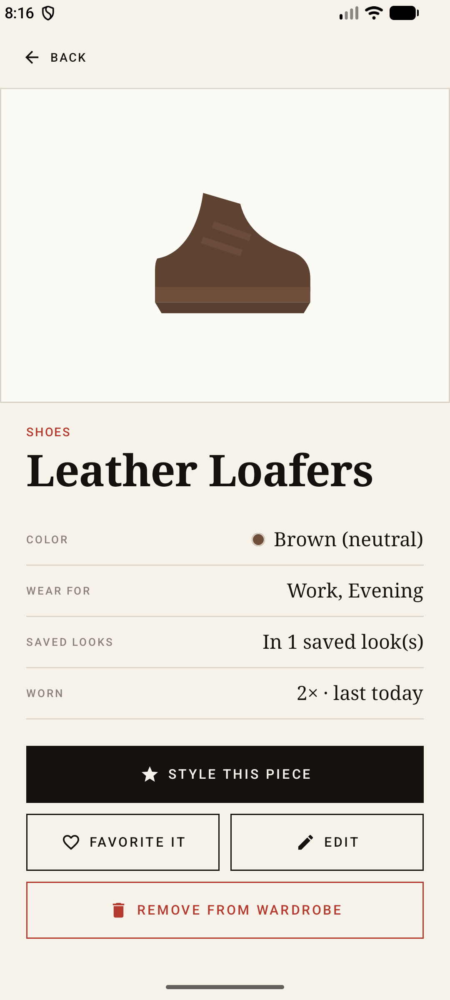 | 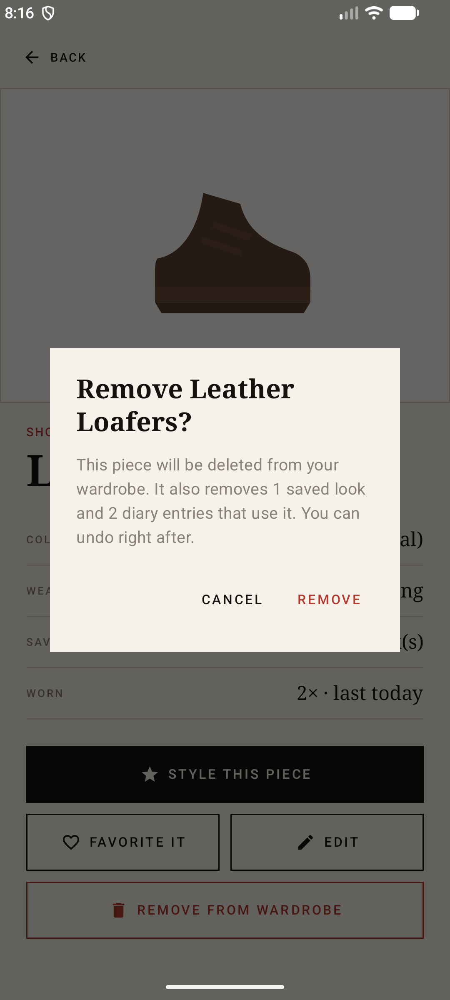 | 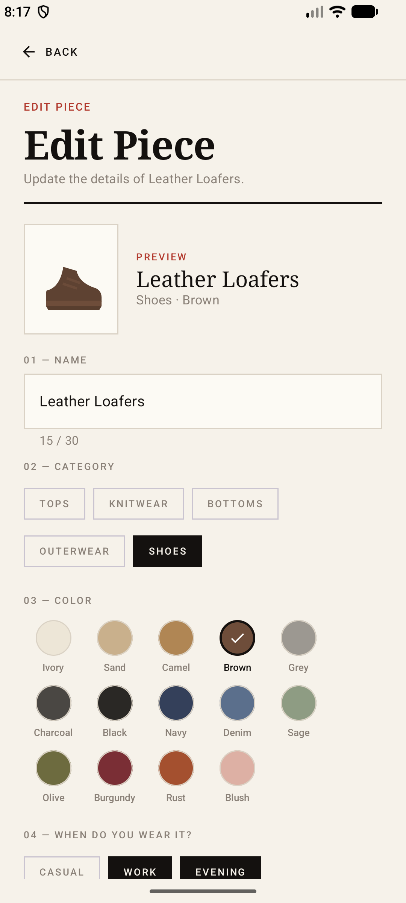 |

### Earlier homework screens (all still functional)

| Home | My Wardrobe | Add a Piece |
|---|---|---|
| 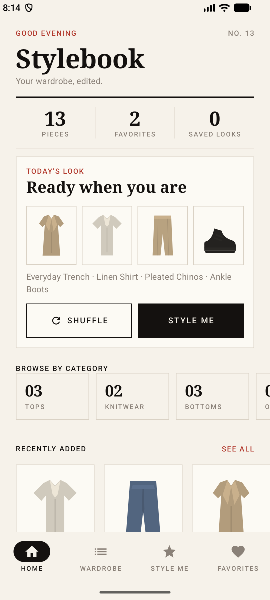 | 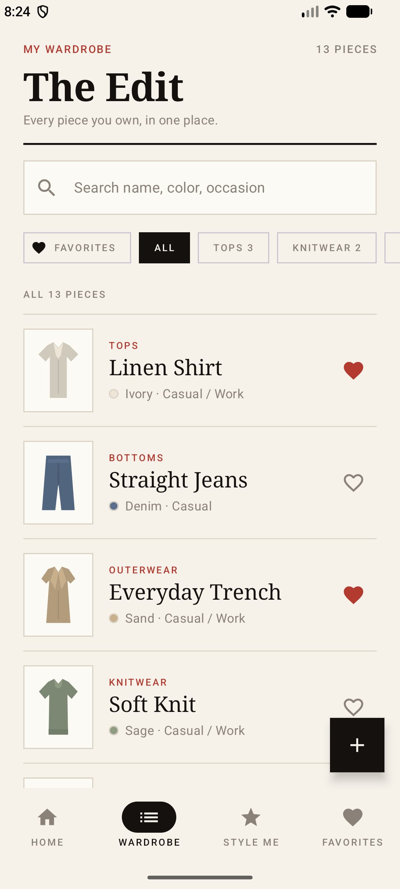 | 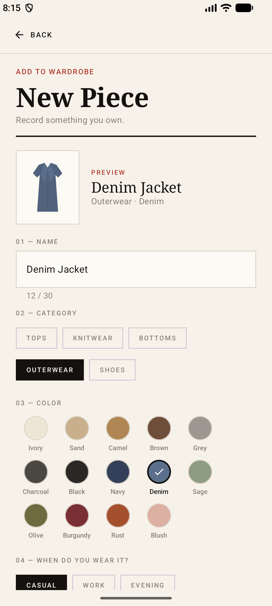 |
| **Outfit Generator** | **Favorites** | **Item Detail** |
| 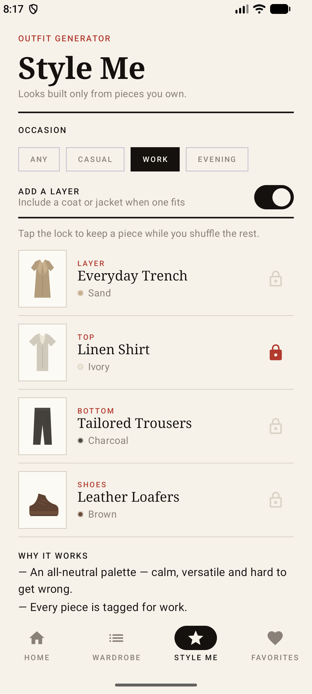 | 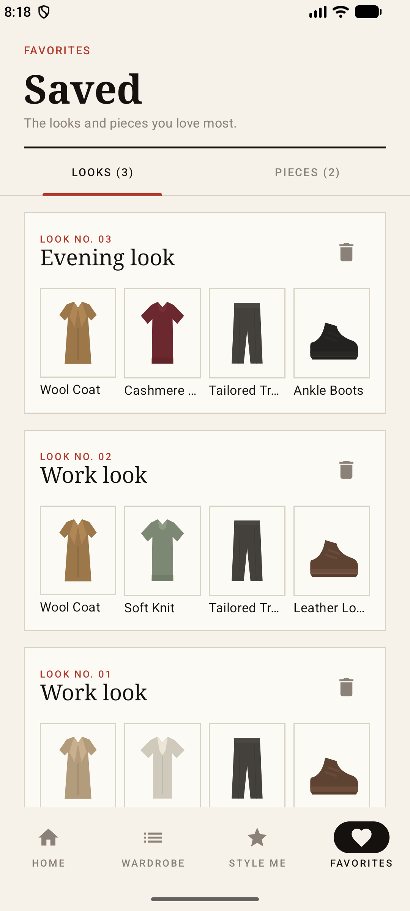 | 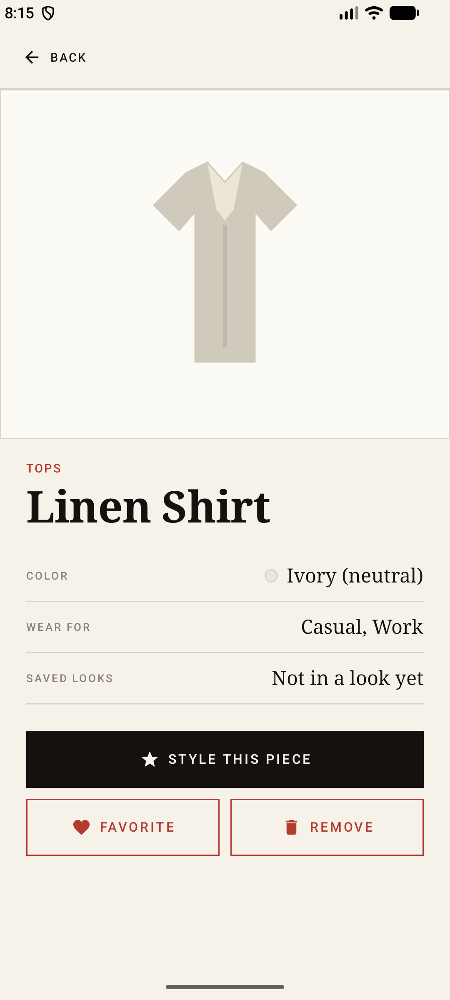 |

## Features

| # | Feature | What the user can do |
|---|---|---|
| 1 | **Wardrobe catalogue** | Browse every piece in a `LazyColumn` with stable keys (`key = { it.id }`). Search by name, category, color or occasion. Filter by category chip or favorites only. **Sort** by Newest, A–Z, Most worn or Least worn. A friendly empty state appears when nothing matches. |
| 2 | **Create / edit a piece** | One form for both. Fields are name, category, color and occasions. Validation covers required fields, name length (2–30 characters), and duplicate names within the same category (a piece being edited is not its own duplicate). Errors appear inline only after the first submit. |
| 3 | **Delete with confirmation** | *Remove from wardrobe* opens a dialog that says how many saved looks and diary entries will also be removed. After you confirm, a snackbar offers **Undo**, which restores the piece and all related rows. |
| 4 | **Outfit Generator** | Builds a top + bottom + shoes (+ optional layer) look **only from pieces you own**. Choose an occasion, toggle the layer, **lock** pieces and **shuffle** the rest. It uses color harmony (at most one accent color) and shows a *"Why it works"* explanation. |
| 5 | **Favorites** | Save generated looks (duplicates are detected) and favorite individual pieces. Saved looks can be removed with **Undo**. |
| 6 | **Item detail** | See color, occasions, how many saved looks use the piece, and **how often and when it was last worn**. Actions: *Style this piece*, favorite, **Edit**, **Remove**. |
| 7 | **Wear Diary (additional feature)** | See [below](#additional-feature-wear-diary). |

### Additional feature: Wear Diary

This feature spans several screens and interactions, changes state, and stores its data in Room (`wear_log` table):

1. **Log a look.** *Wear today* on the generator, or on any saved look in Favorites, writes an entry for today. Logging the same look twice on one day is rejected, and the button changes to *In today's diary*.
2. **Diary tab.** A `LazyColumn` of entries grouped by day (*Today*, *Yesterday*, dates), with stable keys `day-<epochDay>` and `wear-<id>`. Three statistics are shown: looks logged this month, pieces worn out of the total, and the most-worn piece.
3. **Forgotten pieces.** Pieces never worn, or not worn for 30+ days, appear oldest-first in a carousel. Tap one, then *Style this piece*, to build a look around it.
4. **Wear again.** Copies a look from an earlier day to today.
5. **Delete an entry.** A confirmation dialog appears first. The pieces and saved looks are kept.
6. **Everywhere else.** Item detail shows *"3× · last yesterday"*, and Wardrobe can sort by *Most worn / Least worn*. Every screen updates the moment a look is logged, because they all observe the same Room `Flow`.
7. **Consistency.** Deleting a piece also deletes the diary entries that used it, and *Undo* brings them back.

## Tech stack

| | |
|---|---|
| Language | Kotlin 2.2.10 |
| UI | Jetpack Compose (BOM 2026.02.01), Material 3 |
| Navigation | Navigation Compose 2.10.2 |
| State | `ViewModel`, `StateFlow`, `collectAsStateWithLifecycle()` (lifecycle 2.11.0) |
| Persistence | **Room 2.8.4** (KSP 2.3.4), `Flow` queries, `withTransaction` |
| Async | Kotlin Coroutines (`viewModelScope`, `Channel`, `combine`, `stateIn`) |
| Dates | `java.time.LocalDate` (core library desugaring for API 24–25) |
| Tests | JUnit 4 + `kotlinx-coroutines-test`; instrumented Room tests |
| Build | AGP 9.4.1, compileSdk/targetSdk 37, minSdk 24 |

## Architecture (MVVM)

```
┌──────────────────────── UI layer (Compose) ────────────────────────┐
│ StyleBookApp: NavHost, bottom bar, FAB, Snackbar                   │
│ screens/*: stateless, receive state + callbacks                    │
│ components/*: reusable composables (ConfirmDialog, OutfitPieces…)  │
└──────────────▲─────────────────────────────────┬───────────────────┘
               │ StateFlow<UiState>              │ events (onClick…)
               │ collectAsStateWithLifecycle()   ▼
┌──────────────┴──────────── ViewModels ─────────────────────────────┐
│ WardrobeViewModel: search/filter/sort, create, edit, delete + undo │
│ OutfitViewModel:   generate, lock, save looks, wear today          │
│ DiaryViewModel:    diary by day, stats, forgotten, delete, again   │
└──────────────▲─────────────────────────────────┬───────────────────┘
               │ Flow<List<…>>                   │ suspend calls
┌──────────────┴──────────── Repository ─────────────────────────────┐
│ WardrobeRepository (interface)                                     │
│ OfflineWardrobeRepository: maps entities ↔ models, transactions    │
└──────────────▲─────────────────────────────────┬───────────────────┘
               │ Flow (re-emits on table change) │ @Insert/@Update/@Query
┌──────────────┴──────────── Data source (Room) ─────────────────────┐
│ StyleBookDatabase (seeded once with sample wardrobe)               │
│ Entities: ClothingItemEntity, SavedOutfitEntity, WearLogEntity     │
│ DAOs: ClothingItemDao, SavedOutfitDao, WearLogDao                  │
└────────────────────────────────────────────────────────────────────┘
  domain/: OutfitGenerator, ClothingItemValidator, WearStats (pure Kotlin)
```

- **Unidirectional data flow.** Composables never change data directly. They call ViewModel methods, the ViewModel calls `suspend` repository functions in `viewModelScope`, Room writes the change, and the DAO `Flow`s emit again. The `StateFlow`s are recomputed and Compose recomposes. **No screen refreshes manually.**
- **One repository for every ViewModel** (provided by `AppContainer`, created in `StyleBookApplication`, injected with `AppViewModelProvider.Factory`). A change made on one screen therefore shows up on all others immediately.
- **Navigation and configuration changes.** ViewModels are Activity-scoped and survive rotation. Form fields and open dialogs use `rememberSaveable`. The data itself lives in Room, so it also survives process death and app restarts.
- **Loading state.** The UI states start with `isLoading = true`. The detail and edit routes wait for the first database result before deciding that a piece no longer exists.

### Room schema

| Table | Columns | Notes |
|---|---|---|
| `clothing_items` | id (PK, auto), name, category, color, occasions, art, isFavorite, addedAt | `occasions` stored as `"CASUAL,WORK"` (TypeConverter). Listed `ORDER BY addedAt DESC`. |
| `saved_outfits` | id, topId, bottomId, shoesId, outerwearId?, occasion? | Foreign keys → `clothing_items` with `CASCADE`. |
| `wear_log` | id, wornOn (epoch day), topId, bottomId, shoesId, outerwearId?, occasion? | Foreign keys → `clothing_items` with `CASCADE`. Indexed by `wornOn`. |

### CRUD → UI mapping

| Operation | Pieces | Saved looks | Diary |
|---|---|---|---|
| **Create** | Add form (FAB / Home) | *Save look* in generator | *Wear today* (generator, Favorites), *Wear again* (Diary) |
| **Read** | Wardrobe, Home, Detail (`Flow`) | Favorites, generator state | Diary, Detail stats, Wardrobe sort |
| **Update** | Edit form, favorite heart | — | — |
| **Delete** | Detail → confirm dialog (+ Undo) | Favorites (+ Undo) | Diary → confirm dialog |

### Project structure

```
app/src/main/java/com/example/stylebook/
├── MainActivity.kt / StyleBookApplication.kt
├── data/
│   ├── AppContainer.kt                  # Manual DI: database → repository
│   ├── WardrobeRepository.kt            # Repository interface + DeletedItem snapshot
│   ├── OfflineWardrobeRepository.kt     # Room implementation
│   ├── SampleClothingData.kt            # 13 sample pieces (seed)
│   ├── local/                           # Entities, DAOs, Converters, Mappers, StyleBookDatabase
│   └── model/                           # ClothingItem, Outfit, WearEntry, Category, ClothingColor, Occasion, GarmentArt
├── domain/                              # OutfitGenerator, ClothingItemValidator, WearStats
└── ui/
    ├── StyleBookApp.kt                  # Scaffold, NavHost, bottom bar, FAB, snackbars
    ├── navigation/                      # Routes + top-level tabs
    ├── viewmodel/                       # Wardrobe/Outfit/Diary ViewModels, AppViewModelProvider, UserMessage
    ├── screens/                         # Home, Wardrobe, ItemForm, ItemDetail, OutfitGenerator, Favorites, Diary
    ├── components/                      # Reusable composables
    └── theme/
```

## How the HW3 requirements are met

| Requirement | Implementation |
|---|---|
| `LazyColumn`/`LazyGrid` with stable keys | Wardrobe `items(visibleItems, key = { it.id })`, Favorites `"outfit-$id"`/`"item-$id"`, Diary `"day-$epochDay"`/`"wear-$id"`, carousels keyed by id. |
| List + detail with Navigation Compose | `wardrobe` → `item/{itemId}` → `item/{itemId}/edit` (typed `Int` arguments), plus `add_item`, `diary` and the other tabs. |
| Create/edit forms with validation | `ItemFormScreen` + `ClothingItemValidator` (required fields, length, duplicate per category, self excluded on edit). |
| Delete with confirmation dialog | `ConfirmDialog` before deleting a piece (Detail) and a diary entry (Diary). |
| Additional feature | **Wear Diary** (see above). |
| ViewModel + StateFlow, `collectAsStateWithLifecycle()` | Three ViewModels expose `StateFlow<UiState>` built with `combine(...).stateIn(...)`, collected in `StyleBookApp`. |
| Separation UI / ViewModel / Repository / data source | `ui/screens` + `ui/components` → `ui/viewmodel` → `data/WardrobeRepository` → `data/local` (Room). |
| State hoisting, reusable composables | Stateless screens; `ConfirmDialog`, `OutfitPiecesStrip`, `WearTodayButton`, `ClothingItemRow`, `GarmentImage`, `EditorialChip`, … |
| Actions via ViewModel methods | e.g. `saveItem`, `deleteItem`, `wearCurrentOutfit`, `deleteEntry`. Composables only call lambdas. |
| Room: Entity + DAO | 3 entities, 3 DAOs, `TypeConverters`, foreign keys, indices, seed callback. |
| Full CRUD | See [CRUD → UI mapping](#crud--ui-mapping). |
| Repository over the database | `OfflineWardrobeRepository` (transactions for delete/restore, duplicate checks). |
| Room `Flow` → automatic UI updates | DAO `observeAll(): Flow<…>` → repository `map`/`combine` → ViewModel `stateIn`. |
| Data persists after restart | Everything is in `stylebook.db`. Sample data is inserted only when the database is first created. |
| Consistency across screens / navigation / rotation | One shared repository; Activity-scoped ViewModels; `rememberSaveable` for forms and dialogs. |

## Running the app

### Android Studio (recommended)
1. Clone the repository and open the project folder in Android Studio.
2. Wait for Gradle sync to finish.
3. Select an emulator or a connected device (Android 7.0 / API 24 or newer).
4. Press **Run ▶**.

### Command line
Gradle needs JDK 17+. The JDK bundled with Android Studio works:

```bash
# macOS example; adjust the path for your system
export JAVA_HOME="/Applications/Android Studio.app/Contents/jbr/Contents/Home"

./gradlew :app:assembleDebug              # build -> app/build/outputs/apk/debug/app-debug.apk
./gradlew :app:testDebugUnitTest          # JVM unit tests
./gradlew :app:connectedDebugAndroidTest  # Room tests (needs a running emulator/device)
./gradlew :app:installDebug               # install on a running emulator/device
```

## Tests

**JVM unit tests (28)** in `app/src/test/`, using `FakeWardrobeRepository` (in memory, same rules as the Room implementation):

- `OutfitGeneratorTest`: slots, occasion + color harmony, layer toggle, locks, missing categories.
- `WardrobeViewModelTest`: loading state, validation, create, **edit** (self not a duplicate, cannot take another piece's name), search, filters, **sort by wear**, favorite toggle, **delete removes related looks/diary and Undo restores everything**.
- `OutfitViewModelTest`: first look after load, save + duplicates, locks, *Style this piece*, delete rebuilds the look, **wear today once per day**, **saved look marked as worn**.
- `DiaryViewModelTest`: grouping by day, most-worn and forgotten pieces, delete entry, wear again.

**Instrumented tests (6)** in `app/src/androidTest/`. `OfflineWardrobeRepositoryTest` runs on an in-memory Room database and covers CRUD, ordering, duplicate rejection, cascade on delete with restore, and deleting a diary entry.

## Limitations

- Garment images are tinted vector illustrations chosen by category. Taking photos is not implemented.
- The outfit generator is rule-based (slots, occasion, color harmony), not machine learning.
- The database schema is version 1 with `exportSchema = false`. A future schema change needs a `Migration`.
